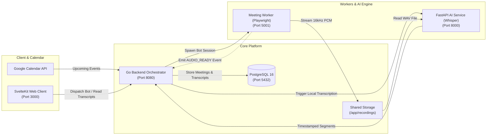

# Spectra

> **Autonomous Enterprise Meeting Intelligence & Local AI Transcription Platform**

Spectra is an end-to-end, enterprise-grade meeting intelligence system designed for confidentiality, reliability, and precision. It synchronizes with Google Calendar, dispatches autonomous headless meeting bots into Google Meet calls, captures high-fidelity mono audio streams directly via browser internals, and transcribes speech locally using Faster-Whisper—ensuring **zero cloud leakage** of sensitive voice data.

---

## 🌟 Key Capabilities

- **Google Calendar Sync & 1-Click Bot Dispatch**: Automatically fetches upcoming schedule details and dispatches bots via `POST /api/calendar/events/:id/join` with built-in deduplication.
- **Stealth Headless Meeting Bot**: Playwright-powered worker with pre-join automation, automated lobby detection ("Waiting to be let in"), and camera/microphone muting.
- **Direct Web AudioWorklet Stream Tap**: Captures clean 16,000 Hz Mono 16-bit PCM audio directly within the browser session, eliminating the need for virtual host audio devices.
- **Rigorous Audio Validation Pipeline**: Enforces 44-byte RIFF/WAVE header compliance, sample-rate integrity, and corruption gating before any AI processing begins.
- **100% Private, Local Faster-Whisper Microservice**: High-throughput FastAPI engine running CTranslate2 with Voice Activity Detection (VAD) and 8-bit quantization on CPU (or optional CUDA acceleration).
- **Event-Driven Go Backend Orchestration**: Manages meeting lifecycles through a deterministic Finite State Machine (`PENDING` $\rightarrow$ `JOINING` $\rightarrow$ `IN_MEETING` $\rightarrow$ `PROCESSING` $\rightarrow$ `COMPLETED`).
- **Dual API Prefix Compatibility**: Transparently mounts routes under both `/api` and `/api/v1` for seamless client and frontend integration.

---

## 🏗️ Architecture & Data Flow



---

## 📁 Repository Structure

```text
Spectra/
├── ai-service/                  # Local Faster-Whisper AI microservice (Python 3.11/FastAPI)
│   ├── src/
│   │   ├── config.py            # Model configuration (base/small/medium, cpu/cuda)
│   │   ├── transcriber.py       # Faster-Whisper & VAD speech segmentation
│   │   └── main.py              # Endpoints: GET /health, POST /v1/transcriptions
│   ├── tests/                   # Pytest test suite (100% pass)
│   ├── requirements.txt         # Pinned production dependencies
│   └── Dockerfile               # Multi-stage Python 3.11 container
│
├── backend/                     # Core business logic and API orchestration (Go 1.22+)
│   ├── cmd/api/main.go          # Server entrypoint and event listener wiring
│   ├── internal/
│   │   ├── api/                 # Common HTTP responses and middleware
│   │   ├── auth/                # Session and credential handling
│   │   ├── calendar/            # Calendar REST endpoints (POST /events/:id/join)
│   │   ├── google/              # Google Calendar and OAuth integration
│   │   ├── meetings/            # Meeting domain model, FSM, and database repository
│   │   ├── router/              # Dual-prefix HTTP router (/api and /api/v1)
│   │   ├── transcription/       # HTTP client for local AI service
│   │   └── worker/              # Meeting worker process and event management
│   ├── migrations/              # PostgreSQL schema migrations
│   ├── tests/                   # Go unit, lifecycle, and integration test suites
│   └── Dockerfile               # Production multi-stage Alpine Go container
│
├── meeting-worker/              # Headless Google Meet browser automation (Node.js/Playwright)
│   ├── src/
│   │   ├── audio/
│   │   │   ├── capture-manager.ts # AudioWorklet browser stream tap
│   │   │   ├── ffmpeg.ts          # Probe & conversion utilities
│   │   │   ├── validator.ts       # 44-byte RIFF/WAVE header validation
│   │   │   └── verify-audio.ts    # 33-step audio verification test harness
│   │   ├── browser.ts           # Chromium stealth launch configuration
│   │   ├── meet.ts              # Meet join automation, lobby detection, AUDIO_READY
│   │   └── types.ts             # Worker telemetry and event types
│   ├── package.json
│   └── Dockerfile               # Containerized Playwright headless runner
│
├── frontend/                    # Modern reactive user interface (SvelteKit + TypeScript)
│   ├── src/                     # Routes, components, API client, and state stores
│   └── Dockerfile
│
├── infra/                       # Infrastructure configuration
│   └── docker-compose.yml       # Production-ready multi-service definition
│
├── .env.example                 # Zero-secret environment template
└── README.md
```

---

## 🚀 Quick Start (Docker Compose)

The fastest and most reliable way to run the entire Spectra stack is via Docker Compose:

### 1. Configure Environment
```bash
cp .env.example .env
```

### 2. Start Services
```bash
docker compose -f infra/docker-compose.yml up --build -d
```

### 3. Verify Health
Once booted, the following services are available:
- **Frontend Dashboard**: `http://localhost:3000`
- **Go Backend API**: `http://localhost:8080/health`
- **AI Transcription Service**: `http://localhost:8000/health`
- **Meeting Worker**: `http://localhost:5001/health`
- **PostgreSQL Database**: `localhost:5432`

---

## 🛠️ Local Development & Running Individually

### 1. Go Backend (`backend/`)
```bash
cd backend

# Run all unit and integration tests
go test -v ./...

# Run the API server locally
go run ./cmd/api
```
*Accessible on port `8080` (or `PORT` defined in your environment).*

### 2. Meeting Worker (`meeting-worker/`)
```bash
cd meeting-worker

# Install dependencies
npm install

# Run the comprehensive 33-step audio verification test suite
npm run test:audio

# Build TypeScript to production JavaScript
npm run build

# Start the worker HTTP server
npm start
```
*Accessible on port `5001`.*

### 3. AI Transcription Service (`ai-service/`)
```bash
cd ai-service

# Create virtual environment and install requirements
python -m venv .venv
source .venv/bin/activate  # On Windows: .venv\Scripts\activate
pip install -r requirements.txt

# Run pytest test suite
pytest -v

# Start the FastAPI service
uvicorn src.main:app --host 0.0.0.0 --port 8000 --reload
```
*Accessible on port `8000`.*

### 4. Frontend (`frontend/`)
```bash
cd frontend
npm install
npm run dev
```
*Accessible on port `3000`.*

---

## 📡 Key API Endpoints

All core endpoints are accessible via both `/api` and `/api/v1` prefixes.

### Meeting Orchestration
| Method | Endpoint | Description |
| :--- | :--- | :--- |
| `POST` | `/api/meetings` | Create and dispatch a bot to a Google Meet URL |
| `GET` | `/api/meetings` | List all tracked meetings and their statuses |
| `GET` | `/api/meetings/:id` | Get details and status of a specific meeting |
| `POST` | `/api/meetings/:id/stop` | Instruct the bot to leave the meeting immediately |
| `GET` | `/api/meetings/:id/transcript` | Retrieve timestamped transcript segments for a meeting |

### Google Calendar Sync
| Method | Endpoint | Description |
| :--- | :--- | :--- |
| `GET` | `/api/calendar/events` | List upcoming Google Calendar events with Meet links |
| `POST` | `/api/calendar/events/:id/join` | Direct 1-click bot dispatch with deduplication |

### AI Microservice
| Method | Endpoint | Description |
| :--- | :--- | :--- |
| `GET` | `/health` | Service health status, hardware device, and active model |
| `POST` | `/v1/transcriptions` | Transcribe WAV audio (via shared path or multipart upload) |

---

## 🔒 Enterprise Privacy & Security

1. **Air-Gapped Audio Processing**: Voice streams are transcribed purely in-memory/on-premise via Faster-Whisper. Audio is never transmitted to OpenAI, Google, or any public AI API.
2. **Path Traversal Protection**: The AI service validates all file path requests against an absolute designated recordings boundary, preventing unauthorized file access.
3. **Bot Transparency**: The meeting bot joins with a clearly designated display name, cameras and microphones permanently muted, and abides by waiting room admissions.
4. **Zero-Secret Codebase**: All sensitive OAuth credentials and database passwords are read strictly from runtime environment variables.

---

## 🧪 Test Verification & Quality Assurance

Spectra maintains a strict "No Fake Success" policy—all features are backed by executable automated tests:

- **Audio Capture & Web AudioWorklet**: 33/33 tests passing (`meeting-worker/src/audio/verify-audio.ts`).
- **AI Transcription Microservice**: 5/5 pytest unit tests passing (`ai-service/tests/test_api.py`).
- **Go Backend**: 100% test pass rate across URL validators, FSM transitions, calendar endpoints, deduplication, and HTTP clients.
- **Docker Compose**: Containerized multi-service validation passing with zero compilation or lint errors.
