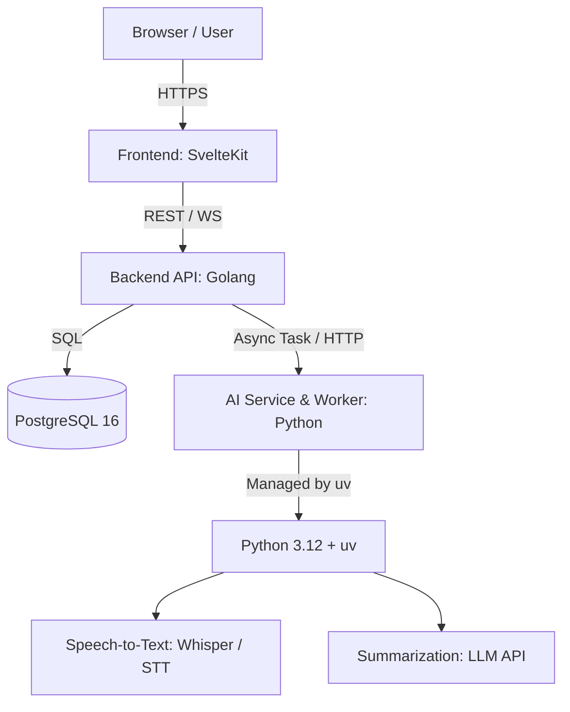

# Spectrum AI - System Architecture

## 1. Overview
Spectrum AI is an intelligent meeting assistant platform designed to join, record, transcribe, and synthesize organizational meetings across Google Meet, Zoom, and Microsoft Teams.

---

## 2. Component Specifications

### 2.1 Frontend (`frontend/`)
- **Framework**: SvelteKit with TypeScript & Vite
- **Styling**: Component-scoped CSS with modern dark UI
- **Responsibilities**:
  - Authentication (Login / Register)
  - Interactive Dashboard (Meeting history, active meetings)
  - Meeting detail viewer (Live/post-meeting transcript, speaker diarization, AI takeaways)
  - Bot dispatch and configuration settings

### 2.2 Backend API (`backend/`)
- **Language**: Go (1.22+)
- **Architecture**: Modular monolith with clear domain boundaries (`internal/auth`, `internal/meetings`, `internal/participants`, `internal/calendar`, `internal/database`)
- **Responsibilities**:
  - Authentication & JWT issuance
  - Meeting scheduling, status lifecycle, and participant management
  - Google Calendar / Outlook integration & sync
  - REST API routing with CORS and structured logging middleware
  - Database migrations & persistence

### 2.3 AI Service & Worker Runtime (Python with `uv`)
- **Package & Runtime Manager**: [`uv`](https://github.com/astral-sh/uv) (Astral)
  - Fast dependency resolution, deterministic `uv.lock`, and zero-overhead virtualenv management.
  - Configuration defined in `pyproject.toml`.
  - Commands:
    - `uv sync`: Install project dependencies.
    - `uv run <command>`: Execute in the synchronized virtual environment.
    - `uv add <package>`: Add new dependencies.
- **Responsibilities**:
  - Headless browser bot automation (joining Meet / Zoom calls)
  - Audio extraction & real-time audio chunk streaming
  - Transcription & speaker diarization
  - LLM-powered meeting summaries, action items, and topic clustering

### 2.4 Infrastructure & Database (`infra/`)
- **Docker Compose**: Containerized multi-service development setup.
- **PostgreSQL 16**: Primary relational storage for users, meetings, participants, transcripts, and AI summaries.

---

## 3. Data Flow

1. **User schedules or requests a meeting bot**:
   - Frontend calls `POST /api/v1/meetings`.
   - Go backend persists the meeting with state `scheduled`.
2. **Bot execution**:
   - Worker joins meeting URL at scheduled time.
   - Captures incoming audio stream and chunks audio data.
3. **Transcription & AI pipeline**:
   - Python transcription service (managed by `uv`) processes speech to text.
   - Summarization engine produces structured action items.
4. **Presentation**:
   - Go backend stores transcripts and summaries into Postgres.
   - SvelteKit frontend fetches and renders transcripts with speaker labels and AI insights.
