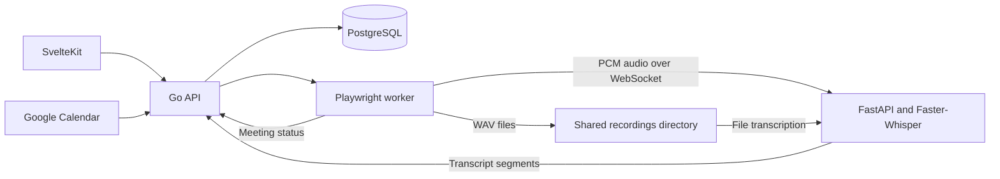

# Spectra architecture

Spectra runs a SvelteKit frontend, a Go API, a Node.js meeting worker, a Python
transcription service, and PostgreSQL. `infra/docker-compose.yml` defines their
container configuration.

## Meeting flow

1. The frontend submits a meeting URL to the Go API.
2. The API stores the meeting and dispatches a worker session over HTTP.
3. The worker opens an isolated browser context, configures media, and requests
   admission. Provider access controls determine whether it can join.
4. Once admitted, the worker captures incoming audio through Web Audio, streams
   PCM to the AI service, and writes a WAV recording.
5. The API stores transcript segments and provides meeting status and transcripts
   to the frontend.

The worker supports Google Meet, Teams, and Zoom through platform adapters.
Support in the worker does not establish that every platform is accepted by the
public API's URL validator.

## Code locations

| Directory | Responsibility |
| --- | --- |
| `backend/internal/router/` | API routes and middleware |
| `backend/internal/meetings/` | Meeting handlers, service, and persistence |
| `backend/internal/worker/` | Worker client and meeting lifecycle |
| `backend/internal/google/` | Google OAuth and Calendar access |
| `meeting-worker/src/platforms/` | Provider join and admission flows |
| `meeting-worker/src/audio/` | Audio capture, streaming, and WAV validation |
| `ai-service/src/` | Transcription endpoints and model configuration |
| `frontend/src/` | Pages, components, API client, and stores |

## Runtime state

The backend, worker, and AI service must share a recordings directory. Container
paths and local paths come from each service's environment.

Meeting browser contexts stay isolated. The worker can load Google cookies from
`meeting-worker/bot-profile/storage.json`. The login provisioner uses a separate
Chrome profile and exports session state for new meeting contexts.

The Windows worker defaults to visible Chrome. Linux containers default to
headless Chrome. See the [setup guide](../README.md) for overrides and login.
